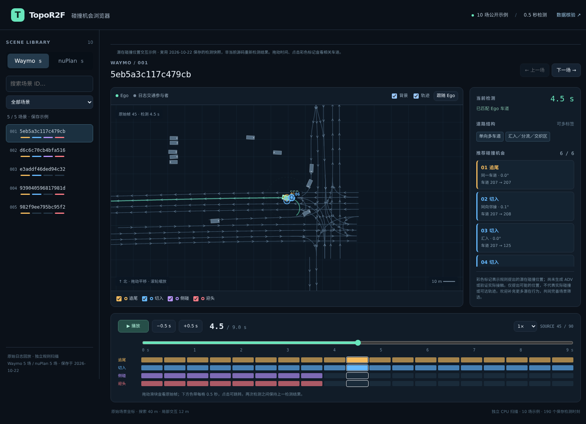

# Collision Type Selector

CPU-only, map-based generation of potential collision locations and collision-type selection for autonomous-driving scenarios. Supports **rear-end, cut-in, side, and head-on** opportunities from ScenarioNet-format inputs.

Given a road map and the logged Ego pose, this tool proposes candidate locations where a collision could potentially occur, together with the corresponding lane relationships and risk types. These locations support subsequent scenario screening and behavior design. They describe geometric possibilities; they do not establish that a collision will happen or that a vehicle can reach the proposed location. Vehicle trajectories and driving behaviors are not generated by this tool.

Extracted from [TopoR2F](https://github.com/Shaw20000101/TopoR2F). Only NumPy is required; no model checkpoint or GPU is needed.

## Interactive examples

**[Download the repository ZIP](https://github.com/Shaw20000101/Collision_type_selector/archive/refs/heads/main.zip)** — extract it and open `docs/index.html` in a current Chrome, Edge, Firefox or Safari browser.

Explore **10 saved scenarios: five Waymo and five nuPlan examples**. Drag the time slider, play the logged scene, filter risk types, and click a proposed location to highlight the relevant lanes. The sample includes all nine road labels and four risk types recognized by the rules.



These examples reuse the saved detection snapshot from **2026-10-22**. They illustrate potential locations rather than validate the current source, actual collisions, or vehicle reachability. Road labels are heuristic; the examples are selected for variety rather than benchmark statistics.

For offline use, download the repository ZIP and open `docs/index.html`, or open that file from a local checkout. The viewer requires no Python installation. Saved scene data is compressed losslessly and restored locally in your browser; use a current browser with `DecompressionStream` support.

## Scenarios and potential collision risks

| Road scenario | Potential collision risks considered |
| --- | --- |
| One-way single-lane road（单向单车道） | Rear-end opportunities along the same directed lane corridor. |
| One-way multi-lane road（单向多车道） | Rear-end opportunities within a lane; cut-in opportunities from mapped adjacent lanes traveling in the same direction. |
| Two-way road with opposing lanes（双向对向车道） | Rear-end opportunities within the Ego corridor; head-on opportunities involving nearby opposing lanes; cut-in opportunities where same-direction adjacent lanes also exist. |
| Curve（弯道） | Rear-end opportunities along the curved corridor; additional cut-in or head-on opportunities when local adjacent or opposing lane relationships support them. |
| Merge, diverge, or weaving region（汇入／分流／交织区） | Cut-in opportunities at merging arms or mapped same-direction adjacent lanes, plus rear-end opportunities along the Ego corridor. A diverging branch alone does not introduce a cut-in opportunity. |
| Lane gain or loss（车道增减路段） | Rear-end opportunities and potential cut-in opportunities where mapped lane adjacency or merging relationships exist. |
| Intersection（交叉口） | Crossing-path opportunities classified by local lane heading difference, especially side collisions; rear-end or head-on opportunities where their corresponding lane relationships exist. |
| Roundabout（环岛） | Rear-end opportunities along the circulating corridor; potential cut-in opportunities where entry/merge or adjacent-lane relationships are detected. |
| U-turn region（掉头区域） | Rear-end opportunities along the turning corridor; additional crossing-path or head-on opportunities where intersecting or opposing lanes are detected. |

The table summarizes risks supported by local lane relationships. A road label alone does not enable every risk listed in its row: the actual map geometry, connectivity and selection checks determine each output. Multiple road labels and collision types can coexist at one location. Curve, lane gain/loss, roundabout and U-turn labels provide road context rather than separate collision categories.

## Install

Use Python 3.10 or newer. Clone the repository and install its only dependency:

```bash
git clone https://github.com/Shaw20000101/Collision_type_selector.git
cd Collision_type_selector
python -m venv .venv
source .venv/bin/activate
python -m pip install -r requirements.txt
```

## Scan a scene

```bash
python scan_collision_opportunities.py \
  --scene /path/to/scenario.pkl \
  --output outputs/scene_scan
```

Repeat `--scene` to scan multiple inputs. The output directory must be new; existing results are not overwritten.

For a batch, prepare a CSV containing a `scenario_file` column. Paths in that column are relative to the dataset directory:

```csv
scenario_file
scene_001.pkl
scene_002.pkl
```

```bash
python scan_collision_opportunities.py \
  --manifest /path/to/scenes.csv \
  --dataset-dir /path/to/dataset \
  --output outputs/batch_scan \
  --interval 0.5
```

The manifest only selects input files; existing collision-type and road labels in the CSV are ignored. Inputs must be trusted pickle files, since loading pickle can execute code.

### Output

Each scene produces a JSON timeline sampled every 0.5 seconds by default. `index.json` records configuration, input/output hashes and per-scene success or failure. A failed input remains recorded, and the command returns a nonzero exit code if any scene fails.

Useful per-frame fields:

| Field | Meaning |
| --- | --- |
| `source_frame`, `time_s` | Original sample index and relative scan time |
| `road_types` | Detected local road structures |
| `potential_collision_types` | Available types: `rear_end`, `cut_in`, `side`, `head_on` |
| `opportunities` | Local lane relations, opportunity points and collision types |

The nine road labels cover single-lane and multi-lane one-way roads, two-way roads, curves, merge/diverge/weaving regions, lane gain/loss, intersections, roundabouts and U-turns. Multiple labels can apply at once.

## Select collision types at a target time

`collision_type_control.py` provides a Python API; it does not have a command-line entry point.

```python
import json
import pickle
from collision_type_control import plan_scene
from scan_collision_opportunities import json_value

with open("/path/to/scenario.pkl", "rb") as stream:
    scene = pickle.load(stream)

plan = plan_scene(scene, mode="auto", collision_time_seconds=9.0)
print(json.dumps(json_value(plan), indent=2))
```

Run your script from the repository root so the two modules are importable. The API returns exactly four planned slots, including rejected slots. It uses only the selected target frame, rather than combining opportunities over a time window.

| Mode | Behavior |
| --- | --- |
| `auto` | Detect local types and assign four slots cyclically in rear-end, cut-in, side, head-on order, skipping unavailable types |
| `manual` | Assign the specified type to all four slots, subject to the applicable input checks |
| `any` | Leave the type unrestricted; this is the API default |

```python
manual = plan_scene(scene, mode="manual", requested_type="cut-in",
                    collision_time_seconds=9.0)
unrestricted = plan_scene(scene, mode="any", collision_time_seconds=9.0)
```

Both `cut-in` and `cut_in` are accepted as input. Planned types use hyphens; scanner types use underscores. The planner accepts target times from 1 to 9 seconds in 0.5-second increments and requires a 10 Hz source timeline (allowing the code's existing timestamp tolerance). If omitted, the target is the final source frame; that time must still meet these constraints. A typical input has 91 samples covering 0–9 seconds.

Check `plan["status"]` and each slot's `status` before using the plan. Only `ready` plans are eligible for downstream use. In manual mode, the requested label remains in the plan even when rejected. Rejected slots remain in the four-slot budget. Manual requests do not generally verify that the requested map opportunity exists.

The location proposal uses XY map geometry and cannot distinguish a grade-separated crossing from an at-grade intersection using elevation. Results depend on map coverage and topology quality. Collision occurrence, trajectory feasibility and scenario quality require separate downstream validation.

## Input format

Use an already converted ScenarioNet scene dictionary saved as a pickle. Raw WOMD TFRecords and raw nuPlan databases require conversion before use. No dataset or converter is bundled.

Minimal dictionary structure (NumPy arrays or compatible lists):

```python
scene = {
    "id": "scene_id",
    "metadata": {"sdc_id": "ego", "ts": timestamps},
    "tracks": {
        "ego": {"state": {
            "position": positions,  # [T, 2 or 3], meters
            "heading": headings,   # [T], radians
            "valid": valid,        # [T], bool
        }}
    },
    "map_features": {
        "lane_id": {
            "type": "LANE_SURFACE_STREET",
            "polyline": points,            # [N, 2 or 3], directed lane centerline
            "entry_lanes": [],             # connected lane IDs
            "exit_lanes": [],
            "left_neighbor": [],           # lane IDs or ScenarioNet neighbor records
            "right_neighbor": [],
            "width": left_right_widths,    # optional [N, 2], left/right half-widths
        }
    },
}
```

Track keys must match the string form of `metadata.sdc_id`. All geometry and headings must share a coordinate frame, and lane centerline order must follow travel direction. Timestamps are in seconds, finite and increasing; if absent, the code assumes 0.1-second sampling. Use native connectivity/neighbor metadata where available; missing metadata can remove opportunities. Optional Ego velocity/length/width fields are retained by the timeline exporter.

## Run the tests

```bash
python -m unittest -v test_scan_collision_opportunities test_intersection_cutin_guard
```

The bundled tests use synthetic maps to check road rules, source sampling, local geometry, boundary cases and rotation/translation invariance. They do not require a dataset. The standalone copy has CPU regression and synthetic API/CLI smoke validation; it does not constitute a new real-dataset experiment.

## Files and provenance

- `scan_collision_opportunities.py`: road geometry, opportunity detection and batch CLI.
- `collision_type_control.py`: target-time type selection and four-slot planning.
- `test_scan_collision_opportunities.py`, `test_intersection_cutin_guard.py`: existing geometry regression tests, copied unchanged.
- `SOURCE_MANIFEST.json`: original paths, workspace status and SHA-256 hashes of the copied sources. These include untracked workspace files, so Git HEAD alone does not identify this version.

The four Python files match the source snapshot recorded in `SOURCE_MANIFEST.json`. Upstream context: TopoR2F `docs/WOMD_VALIDATION500_20261102.md`. The repository includes saved map and logged-motion display data for the ten examples; raw datasets, model weights and generated adversarial trajectories are not bundled.

The demo is ready to serve from `docs/` through GitHub Pages. The source modules and the older saved demonstration have separate provenance. See `DEMO_PROVENANCE.json` and `VALIDATION.json` for their verification scope.

## Publish the demo with GitHub Pages

In this repository, open **Settings → Pages**, choose **Deploy from a branch**, select **main** and **/docs**, and click **Save**. After GitHub finishes deployment, the demo will be available at:

[https://shaw20000101.github.io/Collision_type_selector/](https://shaw20000101.github.io/Collision_type_selector/)

The demo uses static files and needs no build command, server, API key or model checkpoint.

## Contributing

We welcome suggestions for additional potential driving behaviors, road configurations and collision opportunities. Please open an issue with a scenario description and, when available, a map sketch or sample input so we can expand and refine scenario screening together.


